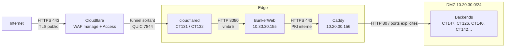

# homelab-security-stack

**Refonte sécurité et réseau d'un homelab Proxmox qui tourne 24/7 — sans coupure constatée.**

Un seul chemin d'inspection pour le web, une DMZ qui ne parle plus au LAN, une PKI
interne à deux niveaux et un pare-feu allowlist qui tient en 132 lignes de script.
Ce dépôt contient les schémas, les choix, les configs sanitizées et les runbooks.
Aucun secret.

[](LICENSE)


---

## Le problème

Le homelab a grossi plus vite que sa documentation. À l'audit du 24 novembre 2026 :

- **7 tunnels Cloudflare** distincts, ~45 ingress, tous les backends en **HTTP clair**.
- **Aucun WAF**. `admin.*`, `checkmk`, `diagrams` et la console du CTF étaient publics.
- **1 zone filtrée sur 6**. `FORWARD policy ACCEPT` entre vmbr1, vmbr2, vmbr3 et vmbr5.
- `:22`, `:8006` et `:3128` de l'hyperviseur joignables **depuis n'importe quel conteneur**.
- Un **SSRF** `/node/<port>/` sur `beta.*` qui proxifiait FlareSolverr, Postgres et Redis.
- Un **conflit d'IP** `10.10.10.66` entre le honeypot et le CTF.
- Un watchdog cron qui **réappliquait l'ancien chemin** toutes les 5 minutes.

## Le résultat

| Indicateur | Avant | Après |
|---|---|---|
| Chemin HTTP public | 6 connecteurs → backends directs | connecteurs → **BunkerWeb** → **Caddy** → backends |
| Origines web | HTTP clair | **TLS interne** (PKI EC P-256) entre WAF et Caddy |
| WAF | aucun | BunkerWeb + CRS, **68 vhosts explicites** |
| Zones filtrées | 1 / 6 | **edge allowlist** + isolation DMZ |
| Hôtes admin sans SSO | 5+ | **0** sur le périmètre testé (302 Access) |
| SSRF `/node/` | 200 | **404** |
| Conflit `10.10.10.66` | ARP instable | **résolu** (CT141 → `.67`) |
| Secrets | tokens dans `ps`, `.env` en clair | **SOPS + age**, tokens en `--token-file` |
| Vhosts testés | — | **65 testés, 0 échec hors origines mortes** |

**Mesures du 24/11/2026, après bascule :**

```text
XSS   GET /?q=<script>alert(1)</script>      → 403  (BunkerWeb)
SQLi  GET /?id=1' OR '1'='1                  → 403  (BunkerWeb)
Page  GET /                                   → 200  (contenu servi)
proxmox / checkmk / diagrams / crafty / freellm → 302 (Cloudflare Access)
admin.sitecreator.shop                        → 200  (honeypot assumé)
Campagne vhosts                               → 65/65, 0 échec hors origines mortes
```

## La chaîne



Détail : [docs/02-architecture-cible.md](docs/02-architecture-cible.md).
Le chemin d'une requête, étape par étape :
[docs/04-matrice-de-flux.md](docs/04-matrice-de-flux.md).

## Stack

| Brique | Rôle | Version |
|---|---|---|
| Proxmox VE | Hyperviseur, 30 LXC + 1 VM | 9.2 |
| Cloudflare Tunnel | Ingress sans port WAN ouvert | cloudflared |
| Cloudflare Access | SSO devant les consoles admin | — |
| BunkerWeb | WAF reverse proxy, ModSecurity CRS, rate limit | 1.6.18 |
| Caddy | Reverse proxy TLS interne, routage par Host | 2.6.2 |
| OpenSSL | PKI root / intermediate / leaf (EC P-256) | 3.x |
| iptables | Segmentation host, chaînes `REFONTE` / `REFONTE-IN` | — |
| SOPS + age | Secrets chiffrés au repos, hors git | 3.13 |
| Debian LXC | 30 conteneurs, bridges Proxmox | 12/13 |

Budget : **0 €**. Pas de pfSense, pas d'OPNsense, pas de matériel dédié.

## Par où commencer

| Vous êtes… | Lisez |
|---|---|
| Pressé | [Avant / après](docs/01-avant-apres.md) — 10 minutes, les 9 changements |
| Curieux du réseau | [Architecture cible](docs/02-architecture-cible.md) puis [plan d'adressage](docs/03-plan-adressage.md) |
| Admin système | [Firewall](docs/08-firewall-segmentation.md) et [runbooks](docs/12-runbooks.md) |
| Sécu | [Threat model](docs/05-threat-model.md) et [matrice de flux](docs/04-matrice-de-flux.md) |
| Recruteur BTS SIO / alternance | [Leçons et limites](docs/13-lecons-et-limites.md) — ce qui reste fragile |

## Contenu du dépôt

```text
.
├── README.md
├── LICENSE
├── SECURITY.md
├── .gitleaks.toml
├── docs/
│   ├── 00-contexte.md            périmètre, contraintes, méthode
│   ├── 01-avant-apres.md         les 8 problèmes, les 9 changements
│   ├── 02-architecture-cible.md  principes, zones, composants, ADR
│   ├── 03-plan-adressage.md      bridges, sous-réseaux, routes
│   ├── 04-matrice-de-flux.md     source → destination → port → décision
│   ├── 05-threat-model.md        actifs, adversaires, 6 scénarios
│   ├── 06-waf-bunkerweb.md       multisite, real IP, faux positifs
│   ├── 07-pki-interne-caddy.md   root / intermediate / leaf, rotation
│   ├── 08-firewall-segmentation.md  chaînes, ordre, strict mode
│   ├── 09-acces-admin-cloudflare.md Access, SSH, honeypot
│   ├── 10-secrets-et-rotation.md SOPS+age, gitleaks, incidents
│   ├── 11-tests-et-validation.md commandes, résultats, rollback
│   ├── 12-runbooks.md            8 procédures prêtes à l'emploi
│   └── 13-lecons-et-limites.md   ce qui marche, ce qui casse encore
├── diagrams/*.mmd                5 schémas Mermaid
├── examples/                     configs sanitizées, à adapter
└── scripts/                      audit et test de vhosts
```

## Configs et scripts

Les fichiers cités dans les docs, directement ici :

| Fichier | Ce que c'est |
|---|---|
| [`examples/docker-compose.bunkerweb.yml`](examples/docker-compose.bunkerweb.yml) | stack WAF complète (5 conteneurs) |
| [`examples/bw.env.example`](examples/bw.env.example) | réglages BunkerWeb, multisite, real IP |
| [`examples/Caddyfile.example`](examples/Caddyfile.example) | routage Host et TLS interne |
| [`examples/gen-pki.sh.example`](examples/gen-pki.sh.example) | root, intermediate, leaf, vérification |
| [`examples/refonte-firewall.sh.example`](examples/refonte-firewall.sh.example) | chaînes `REFONTE` / `REFONTE-IN` |
| [`examples/cloudflared-ingress.example.json`](examples/cloudflared-ingress.example.json) | ingress d'un tunnel vers le WAF |
| [`scripts/audit-vhosts.sh.example`](scripts/audit-vhosts.sh.example) | inventaire lecture seule des vhosts |
| [`scripts/test-vhosts.sh.example`](scripts/test-vhosts.sh.example) | campagne HTTP via WAF + live |

Tous sont marqués « exemple » et contiennent des placeholders. Aucun ne doit
être déployé tel quel.

## Ce que ce dépôt n'est pas

- Pas un produit clé en main : les IP, domaines et noms de conteneurs sont ceux
  d'un lab précis. Les fichiers `examples/` sont marqués comme exemples.
- Pas une architecture haute disponibilité : un seul hyperviseur, un seul edge.
- Pas un audit de code applicatif. Le WAF ne corrige pas une app vulnérable.
- Pas un tutoriel pfSense. Il n'y en a pas, et c'est volontaire
  ([pourquoi](docs/02-architecture-cible.md#pourquoi-pas-pfsense)).

## Sécurité du dépôt

Aucun token, mot de passe, clé privée, tunnel ID, email personnel ni IP publique.
Voir [SECURITY.md](SECURITY.md) et [docs/10-secrets-et-rotation.md](docs/10-secrets-et-rotation.md).

## Licence

MIT — voir [LICENSE](LICENSE).
