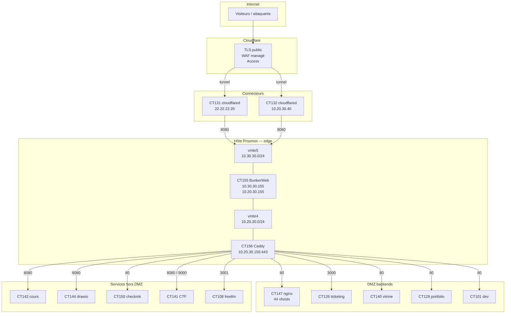

# 02 — Architecture cible

[← Avant / après](01-avant-apres.md) · [README](../README.md) · [Plan d'adressage →](03-plan-adressage.md)

## Les cinq principes

1. **Un seul chemin d'inspection** pour le web public. Si un hostname HTTP
   ne passe pas par le WAF, c'est une exception écrite et justifiée.
2. **Default deny** entre zones. Une règle qui n'existe pas ne s'ouvre pas
   toute seule.
3. **TLS de bout en bout sur les sauts qui comptent.** Cloudflare → connecteur
   est chiffré par le tunnel ; WAF → Caddy est chiffré par la PKI interne.
4. **Le DNS est l'interrupteur de rollback.** Repointer un CNAME suffit à
   revenir en arrière.
5. **Rien d'invisible.** Chaque flux autorisé apparaît dans la matrice.

## Les zones

| Zone | Bridge | Réseau | Rôle | Filtrage |
|---|---|---|---|---|
| LAN physique | `vmbr0` | `192.168.1.0/24` | box, postes, accès admin | entrant limité |
| Interne / NAT | `vmbr1` | `10.10.10.0/24` | jeux, IA, apps historiques | allowlist |
| Prod / apps | `vmbr2` | `22.22.22.0/24` | majorité des services | allowlist |
| CTF | `vmbr3` | `10.66.66.0/24` | hackathon, lab offensif | allowlist |
| DMZ | `vmbr4` | `10.20.30.0/24` | services exposés + edge egress | **isolée** |
| **Transit edge** | **`vmbr5`** | **`10.30.30.0/24`** | **WAF ↔ connecteurs** | allowlist |
| WireGuard | `wg0` | `10.8.0.0/24` | accès admin distant | admin seulement |
| Tailscale | `tailscale0` | `100.64.0.0/10` | accès admin de secours | admin seulement |

`vmbr5` est la nouveauté structurante. Il isole le trafic « connecteur → WAF »
du réseau des backends. Le WAF est **dual-homed** : il reçoit sur `vmbr5`
(`10.30.30.155:8080`) et sort vers Caddy par `vmbr4` (`10.20.30.155`).

## Le chemin d'une requête

1. Le visiteur appelle `https://sitecreator.shop`. Cloudflare termine le TLS
   public et applique son WAF managé.
2. La requête part dans le tunnel sortant du connecteur (CT131 pour les sites
   de l'agence, CT132 pour Cogtopia). Aucun port entrant n'est ouvert sur la box.
3. Le connecteur envoie vers `http://10.30.30.155:8080` en conservant le
   `Host` et en ajoutant `CF-Connecting-IP`.
4. BunkerWeb applique la politique du vhost : CRS, rate limit, taille max.
   Il journalise l'IP réelle du client, pas celle du connecteur.
5. BunkerWeb proxifie vers `https://10.20.30.156:443` (Caddy), en TLS interne.
6. Caddy route par `Host` vers le backend : `10.20.30.147:80` pour les vhosts
   clients, `10.20.30.126:3000` pour le ticketing, etc.
7. Le backend répond. Caddy ajoute les en-têtes de sécurité et renvoie.
8. Si le hostname est admin, Cloudflare Access a déjà exigé une authentification
   **avant** que la requête n'atteigne le tunnel.

Le détail des ports et des décisions est dans
[04 — Matrice de flux](04-matrice-de-flux.md).

## Les composants

### BunkerWeb (CT155)

WAF reverse proxy basé sur nginx + ModSecurity + CRS. Choisi pour trois raisons :

- **multisite natif** : un `SERVER_NAME` par vhost, politiques par site ;
- **docker-compose fourni** : scheduler, UI, base, Redis dans la même stack ;
- **real IP** géré : indispensable derrière un tunnel Cloudflare.

Il tourne sur `vmbr4` + `vmbr5`, avec `API_WHITELIST_IP` limité aux réseaux
Docker internes. Voir [06 — WAF](06-waf-bunkerweb.md).

### Caddy (CT156)

Reverse proxy unique pour 14 backends. `auto_https off` : pas de Let's Encrypt
interne, le certificat vient de la PKI maison. Le Caddyfile est la source de
vérité du routage par Host. Voir [07 — PKI](07-pki-interne-caddy.md).

### PKI interne

Root EC P-256 (10 ans) → intermediate (5 ans) → leaf Caddy (825 jours, SAN
`caddy.dmz.internal` + `10.20.30.156`). La root est montée dans BunkerWeb pour
la vérification. Les clés privées ne sont jamais dans git.

### iptables

Deux chaînes maison, `REFONTE` (FORWARD) et `REFONTE-IN` (INPUT), insérées en
position 1. Elles se terminent par `RETURN`, donc les règles historiques
continuent de s'appliquer si aucune décision n'est prise. Voir
[08 — Firewall](08-firewall-segmentation.md).

### Cloudflare Access

SSO devant les consoles : Proxmox, Checkmk, draw.io, Crafty, la console du CTF,
FreeLLM. Politique par email, session courte, rien à installer côté serveur.
Voir [09 — Accès admin](09-acces-admin-cloudflare.md).

### SOPS + age

Les secrets de l'edge (tokens de tunnel, token API Cloudflare, mot de passe de
la base BunkerWeb) sont chiffrés dans un fichier YAML versionnable. La clé age
vit sur CT131, en `600`, et ne doit **jamais** entrer dans git. La PKI est
sauvegardée de la même façon dans une archive chiffrée. Voir
[10 — Secrets](10-secrets-et-rotation.md).

## Décisions d'architecture (ADR courtes)

### ADR-01 — WAF devant Caddy, pas WAF par service

**Contexte** : 44 vhosts sur un nginx mutualisé, des apps sur plusieurs autres CT.
**Décision** : un seul WAF, un seul Caddy, routage par Host.
**Conséquence** : point unique à surveiller, une panne WAF coupe le web.
**Alternative rejetée** : un WAF par site (44 stacks à maintenir).

### ADR-02 — PKI privée à deux niveaux

**Contexte** : noms `.internal`, pas de DNS public, besoin de vérifier le hop.
**Décision** : root hors ligne à terme, intermediate sur CT156, leaf Caddy.
**Conséquence** : distribution manuelle de la root, rotation à la main.
**Alternative rejetée** : certificats auto-signés par service (aucune chaîne).

### ADR-03 — Séparation sur l'hôte, pas dans pfSense

**Contexte** : contrainte C3, pas d'équipement dédié.
**Décision** : iptables sur l'hôte Proxmox, chaînes dédiées en tête de FORWARD.
**Conséquence** : l'hôte devient un point de défaillance réseau.
**Alternative rejetée** : VLAN filtering Proxmox (plus propre, plus long à tester).

### ADR-04 — Garder Cloudflare Tunnel

**Contexte** : pas d'IP publique fixe, pas d'ouverture de port.
**Décision** : tunnel sortant, TLS public chez Cloudflare.
**Conséquence** : dépendance à Cloudflare, debug via `cloudflared`.
**Alternative rejetée** : reverse proxy public + DDNS + ports ouverts.

### ADR-05 — Caddy pour le Host, nginx reste pour les sites

**Contexte** : 44 vhosts clients dans nginx, migration impossible en une nuit.
**Décision** : Caddy route par Host, nginx continue de servir les sites.
**Conséquence** : deux niveaux de configuration à garder alignés.
**Alternative rejetée** : tout migrer dans Caddy (risque de régression trop haut).

### ADR-06 — WAF en détection puis blocage

**Contexte** : risque de faux positifs sur des sites clients.
**Décision** : `detection` le temps de lire les logs, puis `block`.
**Conséquence** : une fenêtre où le WAF n'empêche rien.
**Alternative rejetée** : blocage immédiat (casse un formulaire, un back-office).

## Pourquoi pas pfSense

La question revient souvent. Trois raisons :

1. **Pas de matériel dédié** et pas envie d'ajouter une VM pare-feu sur le même
   hyperviseur : on déplace le point de défaillance sans gagner en résilience.
2. **Le trafic est déjà routé par l'hôte Proxmox.** Les bridges sont des
   switches L2 internes ; iptables voit tout le trafic inter-zones. Un pfSense
   en VM imposerait de refaire le plan d'adressage et les routes.
3. **Le besoin est une allowlist L3/L4**, pas du NAT, pas du VPN site-à-site,
   pas de HA. 132 lignes de script suffisent et se relisent en dix minutes.

Ce n'est pas un dogme. Le jour où il y aura plusieurs hyperviseurs ou un besoin
de filtrage applicatif centralisé, un vrai routeur/pare-feu dédié aura du sens.

## Ce qui est volontairement absent

- Pas de mTLS entre WAF et Caddy (phase 2).
- Pas d'IDS/IPS réseau (Suricata) : le WAF couvre le HTTP, pas le reste.
- Pas de VLAN 802.1Q : segmentation L3, pas L2.
- Pas de haute disponibilité : un WAF, un Caddy, un hyperviseur.
- Pas de Let's Encrypt interne : la PKI maison suffit pour quatre noms.
- Pas de rotation automatique des secrets : SOPS chiffre, il ne planifie pas.

## Suites

- [03 — Plan d'adressage](03-plan-adressage.md)
- [04 — Matrice de flux](04-matrice-de-flux.md)
- [05 — Threat model](05-threat-model.md)
