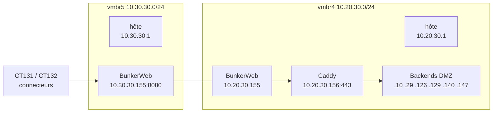

# 03 — Plan d'adressage

[← Architecture](02-architecture-cible.md) · [README](../README.md) · [Matrice de flux →](04-matrice-de-flux.md)

## Bridges

| Bridge | Réseau | Passerelle | Rôle | Avant | Après |
|---|---|---|---|---|---|
| `vmbr0` | `192.168.1.0/24` | `192.168.1.254` | LAN physique (box) | ouvert | admin entrant limité |
| `vmbr1` | `10.10.10.0/24` | `10.10.10.1` | interne / NAT (jeux, IA) | ouvert | allowlist partielle |
| `vmbr2` | `22.22.22.0/24` | `22.22.22.1` | prod / apps | ouvert | allowlist partielle |
| `vmbr3` | `10.66.66.0/24` | `10.66.66.1` | CTF / hackathon | ouvert | idem, isolé du reste par le host |
| `vmbr4` | `10.20.30.0/24` | `10.20.30.1` | DMZ exposée | partiellement filtré | **isolée** (DROP intra + sorties contrôlées) |
| **`vmbr5`** | **`10.30.30.0/24`** | **`10.30.30.1`** | **transit edge (nouveau)** | — | allowlist connecteurs → WAF |
| `wg0` | `10.8.0.0/24` | `10.8.0.1` | WireGuard admin | ACCEPT total | admin seulement |
| `tailscale0` | `100.64.0.0/10` | — | admin de secours | accept-all | admin seulement |

`vmbr5` a été créé sans port physique (`bridge-ports none`). Il ne porte que
deux flux : les connecteurs vers le WAF, et rien d'autre.

## Plan de l'edge

| Adresse | Nœud | Interface | Usage |
|---|---|---|---|
| `10.20.30.1` | hôte Proxmox | vmbr4 | passerelle DMZ |
| `10.20.30.155` | CT155 `edge-waf` | vmbr4 | sortie WAF → Caddy |
| `10.20.30.156` | CT156 `edge-proxy` | vmbr4 | Caddy, TLS interne |
| `10.30.30.1` | hôte Proxmox | vmbr5 | passerelle transit |
| `10.30.30.155` | CT155 `edge-waf` | vmbr5 | écoute WAF `:8080` |

Le double adressage du WAF est volontaire. Il crée une **rupture de zone** :
le trafic entre par `vmbr5` et sort par `vmbr4`. Une compromission du WAF ne
donne pas directement accès au bridge des connecteurs, et inversement.



## Plages réservées

| Plage | Usage |
|---|---|
| `.1` | passerelle du bridge |
| `.2 – .9` | infrastructure (DNS, supervision) |
| `.10 – .99` | applicatif / clients |
| `.100 – .149` | labs, builds, temporaire |
| `.150 – .199` | edge (WAF, Caddy, proxys) |
| `.200 – .254` | réservé, ne pas allouer |

La règle est simple : **l'edge ne partage jamais une plage avec l'applicatif**.
Ça évite les règles iptables qui matchent « tout le bridge sauf… ».

## Le conflit `10.10.10.66`

Deux conteneurs déclaraient la même IP sur `vmbr1` :

| CT | Rôle | MAC | IP |
|---|---|---|---|
| 138 | honeypot OpenCanary | `bc:24:11:1c:0f:e3` | `10.10.10.66` |
| 141 | CTF / hackathon | `bc:24:11:48:de:e5` | `10.10.10.66` |

Symptômes : réponses ARP alternées, flux qui marchent une fois sur deux,
diagnostics incohérents (un test passe depuis un CT, échoue depuis un autre).
C'est exactement le genre de bug qui fait perdre une soirée.

**Correctif** : CT141 passe à `10.10.10.67`. Le honeypot garde `.66`.

**Vérification** :

```bash
# une seule MAC doit répondre
arping -c 3 10.10.10.66
ip neigh flush dev vmbr1
pct exec 141 -- ip -4 addr show eth1
pct exec 138 -- ip -4 addr show eth1
```

**Leçon** : une IP réservée dans un wiki ne vaut rien. La source de vérité,
c'est `pct config` + un scan ARP avant d'allouer.

## Routes du connecteur CT116

CT116 était censé être le connecteur edge, mais il n'avait **aucune route IPv4
par défaut**. Il recevait une default IPv6 par RA et rien en IPv4 : impossible
de joindre le WAF, donc impossible de servir de connecteur.

Correctif, sous forme d'unité systemd oneshot :

```ini
[Unit]
Description=Routes IPv4 edge + DNS
After=network-online.target
Wants=network-online.target

[Service]
Type=oneshot
ExecStart=/sbin/ip route replace default via 10.10.10.1 dev eth1
ExecStart=/sbin/ip route replace 10.30.30.0/24 via 10.10.10.1 dev eth1
ExecStart=/bin/sh -c 'printf "nameserver 1.1.1.1\n" > /etc/resolv.conf'
RemainAfterExit=yes

[Install]
WantedBy=multi-user.target
```

```bash
systemctl enable --now refonte-edge-routes.service
ip -4 route
curl -sS -o /dev/null -w '%{http_code}\n' http://10.30.30.155:8080/
```

Le service est nécessaire parce que `/etc/network/interfaces` du conteneur ne
pose pas de default route : la configuration réseau du LXC est gérée par
Proxmox, pas par l'invité.

## DNS

| Type | Cible | Proxy Cloudflare |
|---|---|---|
| Apex `sitecreator.shop`, `cogtopia.events` | CNAME de tunnel | oui |
| `*` (wildcard) | CNAME de tunnel | oui |
| Sous-domaines admin | CNAME de tunnel + Access | oui |
| `play.*` (Minecraft) | CNAME playit.gg | **non** (assumé) |
| Pages statiques | Cloudflare Pages | oui |

Pas d'enregistrement DNS ne doit pointer vers une IP RFC1918 : Cloudflare
refuserait de proxifier, et le nom fuiterait le plan d'adressage interne.

## Tags Proxmox

Les 35 LXC + la VM sont tagués pour le tri dans l'UI, sans effet fonctionnel :

| Dimension | Tags |
|---|---|
| Environnement | `prod`, `dev`, `lab`, `stopped` |
| Zone | `z-lan`, `z-core`, `z-svc`, `z-lab`, `z-dmz`, `z-edge` |
| Exposition | `public`, `admin`, `internal` |
| Rôle | `web`, `db`, `api`, `ai`, `game`, `media`, `monitoring`, `security`, `tunnel`, `bot`, `client`, `school`, `tools`, `pki`, `waf` |

Exemple : `pct set 147 --tags "prod;sitecreator;web;clients;public;z-dmz"`.

## Ce qui reste à faire

| Sujet | État | Pourquoi c'est important |
|---|---|---|
| DHCP `CT110` sur le LAN physique | non traité | une IP dynamique dans une allowlist, ça casse au reboot |
| VLAN 802.1Q | non fait | la segmentation est L3, pas L2 |
| Inventaire DNS automatisé | non fait | des CNAME orphelins subsistent (`grafana`) |
| Documentation du backup réseau | corrigé partiellement | l'ancien backup ne contenait ni `vmbr5` ni `wg0` |

## Suites

- [04 — Matrice de flux](04-matrice-de-flux.md)
- [08 — Firewall](08-firewall-segmentation.md)
- [12 — Runbooks](12-runbooks.md)
