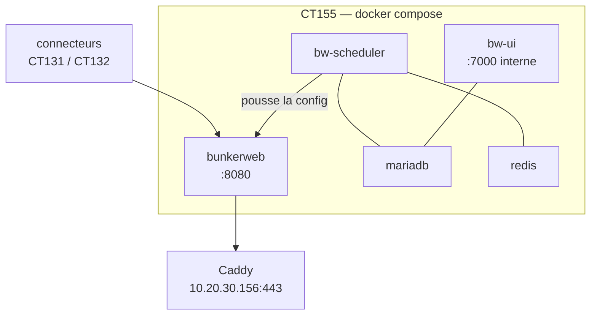

# 06 — WAF : BunkerWeb

[← Threat model](05-threat-model.md) · [README](../README.md) · [PKI →](07-pki-interne-caddy.md)

## Pourquoi BunkerWeb

Le besoin : inspecter le HTTP de **68 vhosts** derrière un tunnel Cloudflare,
sans réécrire les 44 sites clients, avec une configuration lisible.

| Option | Pour | Contre | Verdict |
|---|---|---|---|
| **BunkerWeb** | multisite natif, CRS, real IP, compose fourni | image lourde, beaucoup de réglages | **retenu** |
| ModSecurity + nginx à la main | contrôle total | tout à écrire, maintenance | trop long pour une nuit |
| Cloudflare WAF seul | zéro infra | pas de contrôle sur les règles, pas d'inspection après le tunnel | insuffisant |
| naxsi | léger | règles moins riches que CRS, peu maintenu | non |
| HAProxy + règles maison | rapide | pas de WAF | non |

BunkerWeb apporte aussi une UI et un scheduler : la configuration peut vivre
dans un `env_file` versionnable (sans secrets) et être poussée sans rebuild.

## La stack



Cinq conteneurs, un réseau `bw-universe` en `172.30.0.0/24`, une base MariaDB
pour l'état, Redis pour le cache. L'API n'est accessible que depuis
`127.0.0.0/8` et `172.30.0.0/24` :

```yaml
API_WHITELIST_IP: "127.0.0.0/8 172.30.0.0/24"
```

Sans cette limite, l'API du WAF serait un panneau d'administration de plus.

## Multisite explicite : 68 noms, zéro wildcard

C'est le point qui surprend quand on arrive de nginx.

```ini
MULTISITE=yes
SERVER_NAME=sitecreator.shop www.sitecreator.shop cogtopia.events \
            www.cogtopia.events help.cogtopia.events \
            support.sitecreator.shop ... # 68 noms au total
```

**Pourquoi pas `*.sitecreator.shop` ?** BunkerWeb ne gère pas les wildcards
dans `SERVER_NAME`. Chaque hostname doit être déclaré. Conséquences :

| Avantage | Inconvénient |
|---|---|
| politique par site possible (exclusions, rate limit) | ajouter un client = modifier la config |
| pas de wildcard qui avale un sous-domaine oublié | risque de dérive entre nginx, Caddy et BunkerWeb |
| logs par vhost | 68 lignes à relire |

**Le piège opérationnel** : un `Host` absent de `SERVER_NAME` retombe sur le
vhost par défaut du WAF — mauvaise origine, 404, ou page d'un autre site. Donc
l'ordre d'ajout d'un vhost est :

```text
1. BunkerWeb SERVER_NAME   (sinon le Host n'est pas routé)
2. Caddyfile               (sinon Caddy répond 404)
3. DNS / ingress tunnel    (sinon personne n'arrive)
4. test curl               (sinon on découvre en prod)
```

La liste est générée depuis les vhosts nginx réels, puis comparée à la main.
Pas encore d'automatisation : c'est une dette assumée
([runbook RB-01](12-runbooks.md#rb-01--ajouter-un-vhost)).

## Les réglages, et pourquoi

| Réglage | Valeur | Raison |
|---|---|---|
| `SECURITY_MODE` | `block` | après une phase `detection` |
| `USE_MODSECURITY` | `yes` | moteur de règles |
| `USE_MODSECURITY_GLOBAL_CRS` | `yes` | OWASP Core Rule Set |
| `USE_REVERSE_PROXY` | `yes` | BunkerWeb est le reverse proxy |
| `REVERSE_PROXY_WS` | `yes` | n8n, OpenProject, draw.io, ttyd |
| `REVERSE_PROXY_INTERCEPT_ERRORS` | `no` | préserver les 401/403/404 des apps |
| `USE_REAL_IP` | `yes` | rate limit et logs sur la vraie IP |
| `REAL_IP_HEADER` | `CF-Connecting-IP` | en-tête posé par Cloudflare |
| `USE_BAD_BEHAVIOR` | `no` | faux positifs sur les 401 Basic Auth |
| `USE_LIMIT_REQ` | `yes` | anti-bruteforce basique |
| `LIMIT_REQ_RATE` | `20r/s` | valeur globale, à affiner par site |
| `USE_ANTIBOT` | `no` | trop agressif pour des sites vitrines |
| `MAX_CLIENT_SIZE` | `50m` | uploads draw.io / rapports |
| `AUTO_LETS_ENCRYPT` | `no` | TLS public terminé par Cloudflare |
| `REVERSE_PROXY_SSL_VERIFY` | `no` | phase 2 (voir plus bas) |

## Détection puis blocage

Un WAF activé en `block` le jour de la bascule casse des formulaires. La
séquence a donc été :

1. **`detection`** : on laisse passer, on logue ce que CRS aurait bloqué.
2. Lecture des logs, tri entre vrai positif et faux positif.
3. Exclusions ciblées par règle et par vhost.
4. **`block`**, puis re-test des 65 vhosts.
5. Rejeu des payloads XSS/SQLi pour vérifier que le blocage est effectif.

```bash
# payloads de contrôle (URL-encodés pour passer le shell)
curl -s -o /dev/null -w '%{http_code}\n' \
  'https://sitecreator.shop/?q=%3Cscript%3Ealert(1)%3C%2Fscript%3E'
# attendu : 403

curl -s -o /dev/null -w '%{http_code}\n' \
  "https://sitecreator.shop/?id=1%27%20OR%20%271%27%3D%271"
# attendu : 403

curl -s -o /dev/null -w '%{http_code}\n' 'https://sitecreator.shop/'
# attendu : 200
```

Le troisième test est le plus important. Un WAF qui bloque tout est un WAF
inutile : il pousse les utilisateurs à contourner.

## Real IP : indispensable, et dangereux

Derrière un tunnel, toutes les requêtes arrivent de l'IP du connecteur. Sans
`real_ip`, le rate limit s'applique à `22.22.22.20` — donc à tout le monde — et
les logs ne servent à rien.

```ini
USE_REAL_IP=yes
REAL_IP_FROM=22.22.22.20 10.20.30.40
REAL_IP_HEADER=CF-Connecting-IP
```

`REAL_IP_FROM` est une **liste de confiance**. Tout hôte qui y figure peut
écrire `CF-Connecting-IP: 1.2.3.4` et faire croire qu'il est quelqu'un d'autre :
contournement du rate limit, pollution des logs, faux bannissements.

La liste a été resserrée aux **deux connecteurs actifs** (CT131 et CT132). Les
IP historiques — honeypot, beta, CT116 — ont été retirées. CT116 et CT111 sont
arrêtés, leurs tunnels ne servent plus. Une liste courte est plus facile à
auditer qu'une liste « au cas où ».

Règle : une IP n'entre dans `REAL_IP_FROM` que si elle héberge un connecteur
Cloudflare actif. Pas un conteneur, pas un honeypot, pas un « on ne sait jamais ».

## Les faux positifs qui ont coûté du temps

### 401 sur Basic Auth

Checkmk et quelques vhosts renvoient `401` avec `WWW-Authenticate`. Le plugin
« bad behavior » de BunkerWeb compte les 401 comme un comportement suspect :
au bout de quelques essais, un admin légitime se fait bloquer.

→ `USE_BAD_BEHAVIOR=no`. On perd une protection anti-bruteforce générique, on
garde le rate limit et CRS.

### Pages d'erreur réécrites

Par défaut, BunkerWeb intercepte les erreurs de l'amont. Résultat : le `401`
de l'app devient une page BunkerWeb, et le navigateur n'affiche plus la boîte
de login. Idem pour un `404` applicatif.

→ `REVERSE_PROXY_INTERCEPT_ERRORS=no`. Le WAF redevient transparent sur les
codes de l'app.

### 413 sur les uploads

nginx a un défaut à `1m`. draw.io, OpenProject et les rapports PDF/XLSX
dépassent. `MAX_CLIENT_SIZE=50m` aligne le WAF sur le besoin réel. Côté Caddy,
la limite par défaut est plus haute ; côté nginx CT147, les vhosts concernés
doivent aussi être relevés — sinon le 413 revient plus loin.

## Websockets

Quatre services en ont besoin : n8n, OpenProject (hocuspocus), draw.io, ttyd.
Les vhosts nginx de CT147/CT132 ne posent pas les en-têtes `Upgrade`/`Connection`.
Caddy et BunkerWeb les gèrent (`REVERSE_PROXY_WS=yes`), mais uniquement si le
flux passe par eux. Un vhost qui court-circuite Caddy casse le websocket.

## TLS vers Caddy : chiffré mais pas encore authentifié

```ini
REVERSE_PROXY_HOST=https://10.20.30.156
REVERSE_PROXY_SSL_VERIFY=no
```

Le hop est chiffré. La chaîne n'est pas vérifiée : un attaquant qui contrôle
`10.20.30.156` pourrait se faire passer pour Caddy. En pratique, il faut déjà
être dans la DMZ.

Le certificat porte `SAN DNS:caddy.dmz.internal, IP:10.20.30.156`, donc la
vérification est possible. Ce qui manque, c'est la validation de la chaîne et
de la profondeur côté BunkerWeb. L'activation se fait quand la root est montée
et testée :

```bash
# dans le conteneur : la root doit être présente
docker exec bunkerweb openssl verify -CAfile /etc/ssl/certs/refonte-root.crt \
  /etc/ssl/certs/refonte-root.crt
```

Puis `REVERSE_PROXY_SSL_VERIFY=yes`, redémarrage, et re-test des 65 vhosts.
Tant que ce n'est pas fait, on écrit « chiffré, non authentifié », pas « TLS
vérifié ».

## Logs et tuning

| Où | Quoi |
|---|---|
| `docker logs bunkerweb` | requêtes, décisions, erreurs |
| audit log ModSecurity (dans le conteneur) | règle CRS déclenchée, payload |
| UI BunkerWeb | état des services, config par site |
| Caddy `access.log` | aval, codes réels des backends |

Méthode de tuning :

1. prendre une requête bloquée à tort ;
2. identifier l'ID de règle CRS dans l'audit log ;
3. vérifier que ce n'est pas un vrai positif déguisé ;
4. exclure la règle **pour ce vhost uniquement** ;
5. rejouer la requête, puis la campagne de test.

Ne jamais désactiver CRS globalement pour un formulaire récalcitrant.

## Limites

- **Pas de test de charge.** 20 r/s est un choix, pas une mesure.
- **Pas de politique par route.** Le rate limit est global.
- **Pas de scan de régression.** Les payloads sont testés à la main.
- **Pas de mTLS.** Le hop WAF → Caddy est serveur-auth seulement (et pas encore
  vérifié).
- **Pas de protection contre une faille logique.** Le WAF voit des chaînes, pas
  des intentions.
- **Dépendance à une image Docker.** Pas de build reproductible ni de pin par
  digest.

## Suites

- [07 — PKI interne et Caddy](07-pki-interne-caddy.md)
- [11 — Tests et validation](11-tests-et-validation.md)
- [12 — Runbook panne WAF](12-runbooks.md#rb-04--panne-ou-faux-positif-waf)
