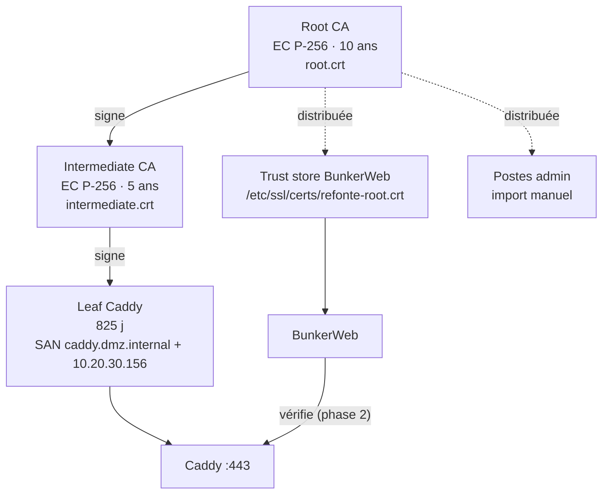

# 07 — PKI interne et Caddy

[← WAF](06-waf-bunkerweb.md) · [README](../README.md) · [Firewall →](08-firewall-segmentation.md)

## Pourquoi une PKI interne

Le hop WAF → Caddy traverse deux bridges (`vmbr5` puis `vmbr4`). Il fallait :

- du TLS entre les deux, sans dépendre d'un nom public ;
- un certificat pour `caddy.dmz.internal` et `10.20.30.156` ;
- une chaîne vérifiable, pas un auto-signé par service ;
- zéro coût, zéro dépendance à Let's Encrypt pour un nom interne.

D'où une PKI à deux niveaux, générée localement, dont la root est distribuée
aux composants qui doivent vérifier (BunkerWeb, postes admin).

## La hiérarchie

| Niveau | CN | Durée | Usage | Clé |
|---|---|---|---|---|
| Root CA | `Refonte Homelab Root CA` | 10 ans (3650 j) | signature de l'intermédiaire | EC P-256, `root.key` |
| Intermediate CA | `Refonte Homelab Intermediate CA` | 5 ans (1825 j) | signature des feuilles | EC P-256, `intermediate.key` |
| Leaf | `caddy.dmz.internal` | 825 j | TLS Caddy `:443` | EC P-256, `caddy.key` |

Extensions :

```text
# root
basicConstraints   = critical, CA:TRUE, pathlen:1
keyUsage           = critical, keyCertSign, cRLSign
subjectKeyIdentifier = hash

# intermediate
basicConstraints   = critical, CA:TRUE, pathlen:0
keyUsage           = critical, keyCertSign, cRLSign
authorityKeyIdentifier = keyid, issuer

# leaf
basicConstraints   = critical, CA:FALSE
keyUsage           = critical, digitalSignature, keyEncipherment
extendedKeyUsage   = serverAuth
subjectAltName     = DNS:caddy.dmz.internal, IP:10.20.30.156
```

`pathlen:1` sur la root signifie « une seule sous-CA autorisée ». `pathlen:0`
sur l'intermédiaire signifie « pas de sous-CA ». C'est le minimum nécessaire.



## Génération

Le script complet est fourni :
[`examples/gen-pki.sh.example`](../examples/gen-pki.sh.example). Il est
idempotent : chaque bloc ne s'exécute que si le fichier n'existe pas.

```bash
#!/usr/bin/env bash
set -euo pipefail
PKI=/etc/caddy/pki
mkdir -p "$PKI"
cd "$PKI"
umask 077

# 1. Root
if [ ! -f root.key ]; then
  openssl ecparam -name prime256v1 -genkey -noout -out root.key
  openssl req -x509 -new -key root.key -sha256 -days 3650 -out root.crt \
    -subj "/CN=Refonte Homelab Root CA/O=Example Lab/OU=Infra" \
    -addext "basicConstraints=critical,CA:TRUE,pathlen:1" \
    -addext "keyUsage=critical,keyCertSign,cRLSign" \
    -addext "subjectKeyIdentifier=hash"
fi

# 2. Intermediate
if [ ! -f intermediate.key ]; then
  openssl ecparam -name prime256v1 -genkey -noout -out intermediate.key
  openssl req -new -key intermediate.key -out intermediate.csr \
    -subj "/CN=Refonte Homelab Intermediate CA/O=Example Lab/OU=Infra"
  cat > intermediate.ext <<'EXT'
basicConstraints=critical,CA:TRUE,pathlen:0
keyUsage=critical,keyCertSign,cRLSign
subjectKeyIdentifier=hash
authorityKeyIdentifier=keyid,issuer
EXT
  openssl x509 -req -in intermediate.csr -CA root.crt -CAkey root.key \
    -CAcreateserial -out intermediate.crt -days 1825 -sha256 \
    -extfile intermediate.ext
fi

# 3. Leaf
if [ ! -f caddy.key ]; then
  openssl ecparam -name prime256v1 -genkey -noout -out caddy.key
  openssl req -new -key caddy.key -out caddy.csr \
    -subj "/CN=caddy.dmz.internal/O=Example Lab/OU=Edge"
  cat > caddy.ext <<'EXT'
basicConstraints=critical,CA:FALSE
keyUsage=critical,digitalSignature,keyEncipherment
extendedKeyUsage=serverAuth
subjectAltName=DNS:caddy.dmz.internal,IP:10.20.30.156
subjectKeyIdentifier=hash
authorityKeyIdentifier=keyid,issuer
EXT
  openssl x509 -req -in caddy.csr -CA intermediate.crt -CAkey intermediate.key \
    -CAcreateserial -out caddy.crt -days 825 -sha256 -extfile caddy.ext
  cat caddy.crt intermediate.crt > chain.crt
fi

chmod 600 ./*.key
chmod 644 ./*.crt
rm -f intermediate.csr caddy.csr intermediate.ext caddy.ext
openssl verify -CAfile root.crt -untrusted intermediate.crt caddy.crt
```

Trois détails qui comptent :

- **`umask 077` avant toute création** : les clés naissent en `600` (moins les
  droits du umask), pas en `644` le temps d'un `chmod`.
- **`chain.crt = leaf + intermediate`** : l'ordre est celui du protocole TLS.
  La root ne va pas dans la chaîne servie, elle va dans le trust store.
- **`-CAcreateserial`** crée `root.srl` / `intermediate.srl` : à conserver pour
  signer les prochains certificats.

## Vérifications

```bash
# Chaîne complète
openssl verify -CAfile root.crt -untrusted intermediate.crt caddy.crt
# attendu : caddy.crt: OK

# Contenu et SAN
openssl x509 -in caddy.crt -noout -subject -issuer -dates -ext subjectAltName

# Ce que sert réellement Caddy
openssl s_client -connect 10.20.30.156:443 -servername caddy.dmz.internal \
  -CAfile root.crt </dev/null 2>/dev/null | openssl x509 -noout -subject -dates

# Le hop complet, depuis le WAF
pct exec 155 -- curl -sS --cacert /etc/ssl/certs/refonte-root.crt \
  -o /dev/null -w '%{http_code}\n' https://caddy.dmz.internal/health
```

Tant que `REVERSE_PROXY_SSL_VERIFY=no`, la dernière commande prouve que le
certificat est **valide**, pas que BunkerWeb le **vérifie**. La nuance est dans
le titre du document.

## Caddy

```caddyfile
{
    admin off
    auto_https off
    log {
        output file /var/log/caddy/access.log {
            roll_size 50MiB
            roll_keep 10
        }
        format json
    }
}

:443 {
    bind 10.20.30.156
    tls /etc/caddy/pki/chain.crt /etc/caddy/pki/caddy.key

    encode zstd gzip

    header {
        Strict-Transport-Security "max-age=31536000; includeSubDomains"
        X-Content-Type-Options "nosniff"
        X-Frame-Options "SAMEORIGIN"
        Referrer-Policy "strict-origin-when-cross-origin"
        -Server
    }

    @support host support.sitecreator.shop
    handle @support { reverse_proxy 10.20.30.126:3000 }

    @sitecreator host sitecreator.shop www.sitecreator.shop *.sitecreator.shop
    handle @sitecreator { reverse_proxy 10.20.30.147:80 }

    respond 404
}
```

Pourquoi `auto_https off` : sans lui, Caddy tente d'obtenir un certificat
public pour chaque `Host`, échoue (noms internes, pas de challenge), et pollue
les logs. Le certificat est statique, fourni par la PKI.

Pourquoi un seul bloc `:443` et pas un bloc par site : un seul certificat, un
seul listener, routage par `Host`. Le prix est un certificat unique dont le SAN
ne correspond pas aux noms publics — acceptable tant que la vérification amont
est désactivée.

Pourquoi `bind 10.20.30.156` : Caddy n'écoute pas sur `0.0.0.0`. Même si le
pare-feu tombe, le service n'est pas joignable depuis `vmbr5`.

## Ce qui est protégé, ce qui ne l'est pas

| Segment | Chiffré | Authentifié | Statut |
|---|---|---|---|
| Navigateur → Cloudflare | oui | oui (CA publique) | OK |
| Cloudflare → connecteur | oui (tunnel) | oui (token) | OK |
| Connecteur → BunkerWeb | **non** (`http://`) | non | intra-`vmbr5`, accepté |
| BunkerWeb → Caddy | **oui** (PKI) | **non** (`verify=no`) | phase 2 |
| Caddy → backend | non (`http://`) | non | intra-DMZ, accepté |
| Caddy → backend hors DMZ | non | non | **dette** |

Le dernier point est le plus gênant : `cours`, `diagrams`, `checkmk`, `freellm`
et le CTF sont joints en HTTP clair depuis Caddy, à travers `vmbr2`/`vmbr3`.
C'est acceptable dans un lab cloisonné, pas dans un datacenter partagé.

## Rotation

### Feuille (tous les 825 jours, ou en cas de compromission)

```bash
cd /etc/caddy/pki
cp caddy.crt caddy.crt.bak-$(date +%F)
cp caddy.key caddy.key.bak-$(date +%F)

openssl ecparam -name prime256v1 -genkey -noout -out caddy.key.new
openssl req -new -key caddy.key.new -out caddy.csr \
  -subj "/CN=caddy.dmz.internal/O=Example Lab/OU=Edge"

# L'extension n'est pas conservée par le script de génération : la recréer.
cat > caddy.ext <<'EXT'
basicConstraints=critical,CA:FALSE
keyUsage=critical,digitalSignature,keyEncipherment
extendedKeyUsage=serverAuth
subjectAltName=DNS:caddy.dmz.internal,IP:10.20.30.156
subjectKeyIdentifier=hash
authorityKeyIdentifier=keyid,issuer
EXT

openssl x509 -req -in caddy.csr -CA intermediate.crt -CAkey intermediate.key \
  -CAcreateserial -out caddy.crt.new -days 825 -sha256 -extfile caddy.ext
cat caddy.crt.new intermediate.crt > chain.crt.new

mv caddy.key.new caddy.key
mv caddy.crt.new caddy.crt
mv chain.crt.new chain.crt
chmod 600 caddy.key && chmod 644 caddy.crt chain.crt

caddy validate --config /etc/caddy/Caddyfile
systemctl reload caddy
```

Rollback : remettre les `.bak`, `systemctl reload caddy`. Le certificat précédent
reste valide, donc pas de coupure pendant la fenêtre.

### Intermédiaire (5 ans)

Implique de re-signer la feuille et de redéployer la nouvelle chaîne. À faire
avec une fenêtre de maintenance, pas à chaud un vendredi soir.

### Root (10 ans)

Implique de redistribuer `root.crt` à BunkerWeb et aux postes admin. C'est un
projet en soi : nouvelle root, nouvelle intermediate, double trust pendant la
transition, puis retrait de l'ancienne.

## Sauvegarde

La PKI complète est archivée et chiffrée avec age dans `pki.tgz.age`, hors du
dépôt. La clé age est sur CT131, en `600`. Après chaque rotation de feuille ou
d'intermédiaire, refaire l'archive :

```bash
tar -C /etc/caddy -czf - pki | age -r "$AGE_RECIPIENT" -o secrets/pki.tgz.age
```

Une archive chiffrée dont la clé est sur le même hôte que l'archive protège
contre un vol de disque, pas contre une compromission de l'hôte. La clé doit
être sauvegardée hors ligne, séparément.

## Les risques de cette PKI

| Risque | Réalité | Mitigation |
|---|---|---|
| Clé root en ligne | `root.key` est sur CT156, pas hors ligne | externaliser la clé ; l'archive chiffrée existe déjà |
| Pas de CRL / OCSP | une clé compromise reste valide | rotation manuelle, durée de vie courte |
| Distribution manuelle | la root doit être importée partout | script + documentation |
| Pas d'audit de signature | rien ne trace qui a signé quoi | journaliser les commandes |
| 825 jours | long pour une feuille | acceptable pour une CA privée, mais à raccourcir |
| Un seul certificat pour tous les vhosts | pas de granularité | acceptable tant que `verify=no` |

Une PKI sans procédure de révocation est une PKI de lab. C'est écrit ici pour
que personne ne la prenne pour autre chose.

## Suites

- [08 — Firewall et segmentation](08-firewall-segmentation.md)
- [12 — Runbook rotation certificat](12-runbooks.md#rb-03--rotation-du-certificat-caddy)
- [13 — Limites](13-lecons-et-limites.md)
