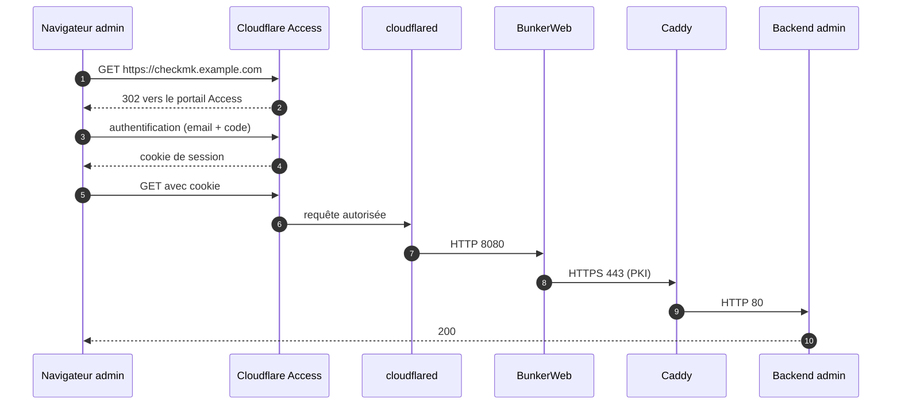

# 09 — Accès admin : Cloudflare Access, SSH, honeypot

[← Firewall](08-firewall-segmentation.md) · [README](../README.md) · [Secrets →](10-secrets-et-rotation.md)

## Le principe

Une console d'administration ne doit jamais être joignable sans authentification,
même si son URL n'est « connue que de moi ». Les scanners trouvent les
sous-domaines en quelques minutes : Certificate Transparency, DNS historiques,
fuites de referrers.

Trois couches, dans cet ordre :

1. **Cloudflare Access** : SSO avant le tunnel. La requête n'atteint jamais le lab.
2. **WAF** : inspection L7 si Access est contourné ou mal configuré.
3. **Firewall** : le backend n'accepte que Caddy, et Caddy n'accepte que le WAF.



## Le périmètre Access

| Hostname | Backend | État | Politique |
|---|---|---|---|
| `proxmox.example.com` | hôte `:8006` | existant, vérifié | email admin |
| `proxmox.example.net` | hôte `:8006` | **corrigé** (était sans SSO) | email admin |
| `vmware.example.com` | VM ESXi arrêtée | existant | email admin |
| `crafty.cogtopia.events` | CT137 `:8443` | existant, vérifié | email admin |
| `checkmk.example.com` | CT150 `:80` | **ajouté** | email admin |
| `diagrams.example.com` | CT144 `:8080` | **ajouté** | email admin |
| `admin.hackaton.example.com` | CT141 `:9000` | **ajouté** | email admin |
| `hackaton-admin.example.com` | CT141 `:9000` | **ajouté** | email admin |
| `dashboard.hackaton.example.com` | CT141 `:8081` | **ajouté** | email admin |
| `n8n.example.com` | CT131 `:5678` | existant | email admin |
| `hermes.example.com` | CT131 `:8790` | existant | email admin |
| `agent.example.com` | CT131 `:9120` | existant | email admin |
| `projects.example.com` | CT131 `:8087` | existant | email admin |
| `rss.example.com` | CT131 `:3002` | existant | email admin |
| `freellm.example.com` | CT108 `:3001` | existant | email admin |
| `automaton.example.com` | CT145 `:8798` | existant | email admin (origine morte) |
| `stripe-automaton.example.com` | CT145 `:8798` | **bypass** | webhook machine |
| `admin.sitecreator.shop` | CT132 `:80` | **honeypot** | aucune, volontaire |

Deux exceptions méritent une explication.

### Le webhook Stripe

Un webhook machine ne peut pas faire un clic sur un portail SSO. Deux options :

- **bypass** sur le hostname (ce qui a été fait) ;
- **service token** (ce qu'il faudrait faire).

Le bypass est une politique Access « Bypass » limitée à ce hostname. Elle
supprime toute protection sur cette URL, y compris contre un scanner qui
découvrirait le nom. Un service token est plus propre :

```bash
curl -H "CF-Access-Client-Id: $CF_ACCESS_CLIENT_ID" \
     -H "CF-Access-Client-Secret: $CF_ACCESS_CLIENT_SECRET" \
     -X POST https://stripe-automaton.example.com/webhook
```

Les deux valeurs sont créées dans Access → Service Auth, et stockées dans le
gestionnaire de secrets de l'app. C'est dans les points ouverts.

### Le honeypot

`admin.sitecreator.shop` répond **200** sans authentification. C'est un piège :
un nginx « admin-trap » qui renvoie une page leurre et logue les requêtes. Il ne
faut **pas** le mettre derrière Access, sinon il devient invisible et inutile.

Règles :

- ne jamais y mettre de données réelles ;
- surveiller les logs (User-Agent, chemins, fréquence) ;
- ne pas le confondre avec une vraie console ;
- le documenter pour que personne ne le « corrige ».

## Access en pratique

### Politique

| Paramètre | Valeur |
|---|---|
| Type d'application | Self-hosted |
| Domaine | le hostname exact |
| Session | durée limitée, renouvellement par SSO |
| Règle | `email == admin@example.com` |
| MFA | porté par l'IdP (Google, GitHub, OTP) |

Une règle par email, pas une règle « everyone ». Et pas de « Bypass » par
commodité : chaque bypass est une porte.

### Vérifier

```bash
# Doit renvoyer 302 vers <team>.cloudflareaccess.com
curl -sI https://checkmk.example.com | head -3

# Sans cookie, on ne doit jamais voir 200
for h in proxmox.example.com checkmk.example.com diagrams.example.com \
         crafty.cogtopia.events; do
  printf '%-32s %s\n' "$h" "$(curl -s -o /dev/null -w '%{http_code}' -I "https://$h")"
done
# attendu : 302 partout
```

Un `200` sur un hostname admin est une alerte. Un `502` peut être normal si
l'origine est morte, mais il ne doit pas précéder un `200`.

## SSH

| Accès | Source autorisée | Authentification |
|---|---|---|
| Hôte Proxmox `:22` | LAN, WireGuard, Tailscale, CT131 | clé ED25519 uniquement |
| Conteneurs `:22` | réseau interne | clé uniquement |
| Console Proxmox | Access → `:8006` | compte PVE + Access |

Ce qui a changé : `:22` de l'hôte n'est plus joignable depuis vmbr1/2/3/5.
Un conteneur compromis ne peut plus rebondir en SSH sur l'hyperviseur.

Le SSH **inter-CT** est aussi filtré : seules les sources d'administration
(CT131, LAN, WireGuard, Tailscale) peuvent ouvrir une session vers un autre
conteneur. Le reste est en `DROP`. Testé le 24/11 :

```text
CT140 → CT147:22   bloqué
CT131 → CT147:22   ouvert
```

Ce qui reste à faire :

- **TOTP sur Proxmox** : Access protège l'accès web, mais un compte PVE volé
  reste un compte PVE. Le second facteur applicatif n'est pas activé.
- **Inventaire des clés** : pas de source de vérité centralisée des clés
  autorisées par CT.
- **Cas particuliers** : certains flux applicatifs peuvent avoir besoin de SSH
  inter-CT ; ils doivent être ajoutés explicitement à la règle 7ter, pas
  contournés.

## Les modes de panne

| Panne | Symptôme | Réaction |
|---|---|---|
| Policy Access trop restrictive | 403 après SSO, boucle de login | ajouter l'email, vérifier le domaine |
| Access indisponible | 302 en boucle ou 5xx Cloudflare | passer par Tailscale/LAN, pas par le web |
| Cookie expiré | retour au portail | re-login |
| Bypass oublié | 200 sans SSO | retirer la policy, tester |
| Origine morte derrière Access | 302 puis 502 | réparer l'origine ou retirer le DNS |

Le point important : **Access ne doit pas être le seul chemin d'administration**.
Tailscale et le LAN restent des accès de secours, hors HTTP public.

## Ce qui n'est pas couvert

- Les comptes Cloudflare eux-mêmes (un compte compromis peut modifier Access).
- Le poste de l'admin (cookie, clé SSH, gestionnaire de secrets).
- Les accès API qui contournent Access (tokens applicatifs).
- Les sous-domaines oubliés : un hostname sans Access reste un trou, même si
  `admin.` est protégé.

## Suites

- [10 — Secrets et rotation](10-secrets-et-rotation.md)
- [12 — Runbook ajout Access](12-runbooks.md#rb-06--ajouter-une-politique-access)
- [13 — Leçons et limites](13-lecons-et-limites.md)
